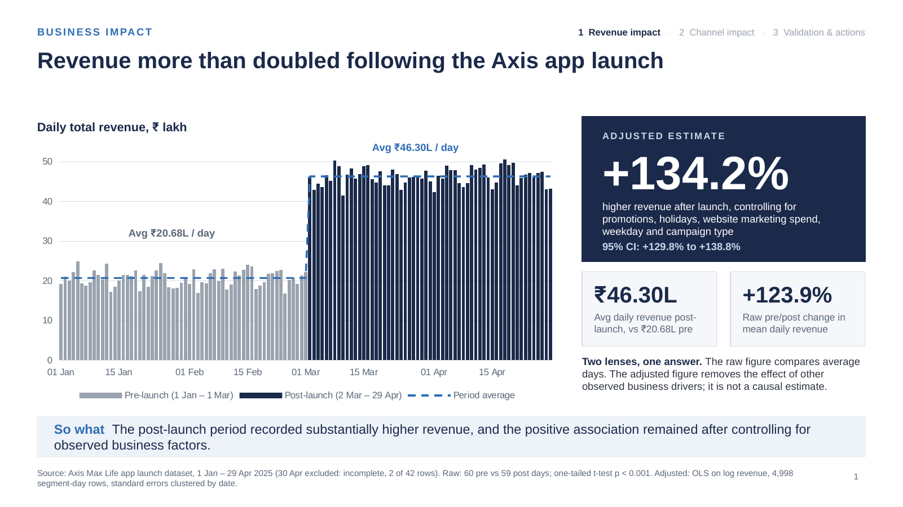
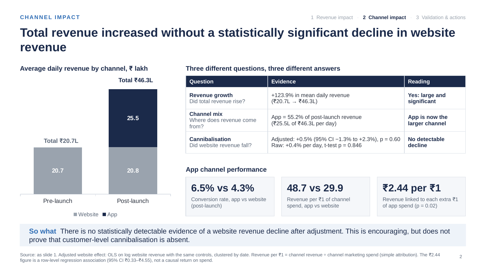
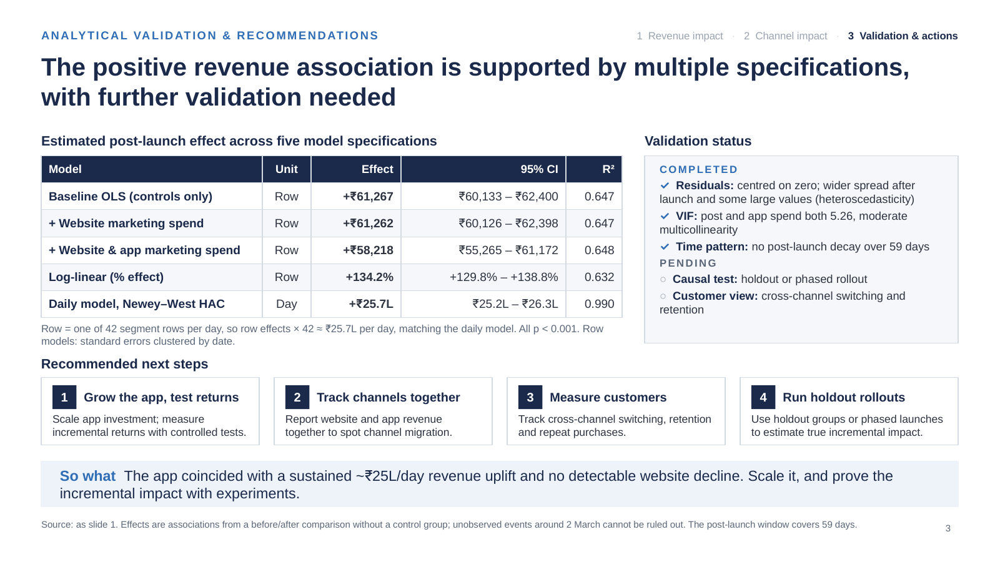

# Axis Max Life: App Launch Impact Analysis

A pre/post business impact analysis of a mobile app launch (2 March 2025) for a life insurance business. The question from leadership: **did the app launch increase revenue, and did it take sales away from the website?**



## Key findings

| Question | Answer |
|---|---|
| Did revenue increase? | **Yes.** Mean daily revenue rose from ₹20.68 lakh to ₹46.30 lakh (+123.9%, one-tailed t-test p < 0.001). Every post-launch day beat the best pre-launch day. |
| By how much, after controls? | **+134.2%** (95% CI +129.8% to +138.8%) in a log-linear regression controlling for promotions, holidays, website marketing spend, weekday and campaign type. In rupees: **₹25.6 lakh per day** (95% CI ₹24.8L to ₹26.4L). |
| Did the app cannibalise the website? | **No detectable decline.** Adjusted website revenue effect +0.5% (95% CI −1.3% to +2.3%, p = 0.60). The app's ₹25.5 lakh per day sits on top of website sales. |
| Spike or sustained? | **Sustained.** Interrupted time-series shows a step change at launch with no change in trend over 59 days; April matched March after the tax-saving deadline. |
| Channel efficiency | App revenue per ₹1 of spend: **48.7** vs **29.9** for the website. App conversion rate 6.5% vs 4.3%. |

These are **associations** from a before/after design without a control group, not causal estimates. The recommendations include holdout tests to measure true incremental impact.

## Methods

- **Data audit:** integrity checks (totals = website + app), missing-value logic, an incomplete date (30 Apr, 2 of 42 rows) excluded, an unreliable column (`app_crashes` is non-zero before the app existed) excluded, IQR outlier review
- **Descriptive statistics:** daily aggregation with ratios calculated as sum ÷ sum, confounder balance check, channel mix
- **Hypothesis testing:** Shapiro–Wilk and Levene assumption checks; one-tailed Student's and Welch's t-tests; Mann–Whitney U; Cohen's d; two-tailed website test; two-proportion z-test on conversion
- **Confidence intervals:** daily lift, monthly and annual ranges, website change, app revenue
- **Regression:** OLS with controls on 4,998 segment-day rows (standard errors clustered by date), linear and log specifications, VIF multicollinearity check, residual diagnostics, daily model with Newey–West (HAC) errors
- **Time pattern:** weekly trend, first vs second month, interrupted time series (segmented regression)
- **Excel validation:** the core t-test and confidence interval are recomputed with native Excel formulas (`T.TEST`, `STDEV.S`, `T.INV.2T`) and match Python exactly

## Repository structure

```
notebooks/     app_launch_impact_analysis.ipynb   full analysis (14 sections, runs top to bottom)
excel/         app_launch_analysis.xlsx           daily data + formula-based spot checks
presentation/  Axis_App_Launch_Impact.pptx        3-slide executive deck
images/        slide previews
```

## Running the notebook

1. Open `notebooks/app_launch_impact_analysis.ipynb` in Google Colab (or Jupyter).
2. Run all cells. In Colab you will be prompted to upload the dataset; locally, place `app_launch_impact_dataset_1.csv` next to the notebook.
3. The final cell exports `app_launch_analysis.xlsx`.

**Data:** the dataset was provided as part of a statistics one-day challenge and is not included in this repository. It has 5,000 rows covering 1 January to 30 April 2025 (about 42 segment rows per day), with website and app visits, conversions, revenue, marketing spend, promotions, holidays and campaign type.

**Tools:** Python (pandas, NumPy, SciPy, statsmodels, matplotlib, seaborn), Excel, PowerPoint.

## The deck




## Limitations

- Before/after design with no control group, so unobserved events around 2 March cannot be ruled out
- Only 59 days of post-launch data; the pre-launch period overlaps the January–March tax-saving season
- Channel ROAS assumes each channel's spend drives its own revenue (simple attribution)
- No customer-level data, so cross-channel switching and retention cannot be measured directly
